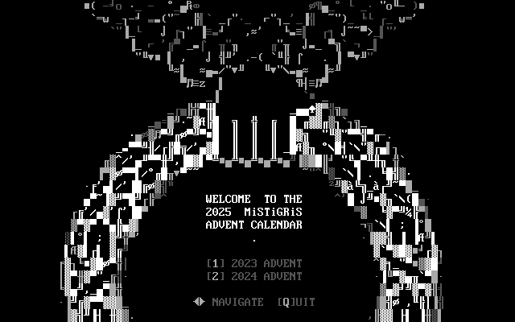

# MiSTiGRiS Advent Calendar



An interactive BBS door program that displays ANSI Christmas art, a new one each day in December. Browse past collections as well. Compatible with all modern BBS systems that support Door32 dropfiles -- Windows and Linux.

## Unified Repository Structure (2025+)

This repository now contains all versions of the Advent Calendar:

- **Go/Modern (Linux, Windows, Mac):** Main Go codebase in root (`cmd/`, `internal/`, etc.)
- **DOS (Legacy):** All Turbo Pascal and DOS-specific files are in `dos/` (NOT 100% functional!! see below)

### Directory Layout

```text
mg_advent/
├── cmd/           # Go entry point
├── internal/      # Go core modules
├── art/           # Modern art assets (Go version)
├── dos/           # All DOS/Turbo Pascal code and assets
│   ├── ADVENT.PAS
│   ├── *.DAT
│   ├── build_utils/
│   └── art/
│       ├── 2023/
│       ├── 2024/
│       ├── 2025/
│       └── common/
└── ...
```

## Quick Setup

Point `-path` at the node's `door32.sys`, or at the directory that contains it
(the file name is matched case-insensitively). No wrapper script is needed; use
whichever your BBS's door command can pass directly:

```text
mg-advent.exe -path C:\bbs\temp\%1             (Windows: node directory)
mg-advent.exe -path C:\bbs\temp\%1\door32.sys  (Windows: drop file)
./advent -path /opt/bbs/temp/%1                 (Linux)
```

Here `%1` stands for whatever node number or drop-file path your BBS
substitutes. All art is built into the executable, so the working directory
doesn't matter.

On Linux, make the binary executable: `chmod +x advent`

To show today's door to callers as they log on, add a second entry to your
logon event with `-logon` added. It shows the day's art for 30 seconds or until
a key is pressed, then returns to the BBS. Outside the December season it exits
immediately without output, so it can stay enabled all year.

### DOS (Legacy)

All DOS code and assets are in `dos/`. You need Turbo Pascal 7 or compatible.

**To build/run in DOSBox or real DOS:**

1. Enter the `dos/` directory:

 ```text
 cd dos
 ```

1. Open `ADVENT.PAS` in Turbo Pascal 7 and compile, or use batch/scripts in `build_utils/` if available.
2. Run the resulting executable in DOS or DOSBox.

Art assets for DOS are in `dos/art/` (identical structure to modern art/).

## Command Line Options

```text
-path string           door32.sys, or the directory containing it
-logon                 Logon mode: show today's door during the season, then exit
-debug-date string     Pretend today is this date (YYYY-MM-DD)
-debug-disable-date    Unlock every installed year and day
-local                 Run locally with UTF-8 art conversion
-nodetect              Use 80x25 without terminal probes
-noice                 Leave terminal ICE mode unchanged
-version               Show version information
```

Sessions end after 5 minutes without a key, or when the caller's BBS time
(from `door32.sys`, at most 2 hours) runs out.

If a terminal reports an implausible screen size (narrower than 80 columns or
shorter than 24 rows) the door uses 80x25. Use `-nodetect` for terminals that
answer the size probe badly.

## How the Calendar Opens

- **Past seasons are open all year.** Every day of every earlier year can be
  browsed at any time, including outside December.
- **The current year opens one door per day in December**, up to the 25th.
  Paging past today's door shows `COMEBACK.ANS`.
- **Future years stay hidden.** A year's art can be installed early; callers
  can't see it until December 1st of that year.
- The door opens on the newest year that can be viewed: the live season in
  December, otherwise the most recent past season. `NOTYET.ANS` appears only
  if no installed year can be opened yet.

## Adding a New Year

1. Create `internal/embedded/art/<year>/` with the daily art named
   `01_DEC26.ANS` through `25_DEC26.ANS` (2025 onward use two-digit days).
2. Add `WELCOME.ANS`, `COMEBACK.ANS` and `GOODBYE.ANS`, plus optional
   `INFOFILE.ANS` and `MEMBERS.ANS`. The welcome screen should list the year
   keys: `1` is the oldest year, counting up to the newest.
3. Rebuild. Missing pieces don't block a release: a year without its own
   WELCOME/COMEBACK/GOODBYE uses `art/common`, and a missing daily file shows
   `MISSING.ANS`, so art can be added as it arrives.
4. Preview before the season with
   `./advent -local -debug-date=2026-12-25` (whole season) or
   `-debug-date=2026-12-03` (as callers will see it on the 3rd).

## Building from Source

### For Modern Systems (Windows 10+, Linux, Mac)

Prerequisites: Go 1.21 or later, Git

```bash
# Clone repository
git clone https://github.com/robbiew/mg_advent.git
cd mg_advent

# Linux/Mac build (builds Linux amd64, arm64, and Windows 386)
./scripts/build.sh

# Windows build
go build -o mg-advent.exe ./cmd/advent
```

### BBS transport and Windows support

BBS connections, terminal probes, single-key input, and raw terminal setup now
use [GoDoors](https://github.com/robbiew/godoors). The Advent display engine keeps
its CP437 art processing, local UTF-8 conversion, overlays, scrolling, and ICE
settings. Navigation keys, local mode, logon mode, and the session limits
remain application features.

`-path` still accepts the full path to `door32.sys` (case-insensitive filename);
a directory containing it is also accepted. Windows uses the inherited socket
when supplied, while Linux/macOS and redirected Windows standard I/O use the
standard streams. No connection is made to a port inferred from a socket handle.
`-nodetect` opens the connection without issuing terminal queries. Detection
shares its buffered input with navigation so typed keys are retained.

Go 1.21 or later is required. Current Windows builds require Windows 10 / Server
2016 or later. The former Go 1.20 / Windows 7 build path is retired; the DOS tree
is unchanged. `WINDOWS7-FIX.md` is historical documentation for older releases.

Build directly on Windows with `go build -o mg-advent.exe ./cmd/advent`. The Unix
build script still produces Linux amd64/arm64 binaries and `mg-advent.exe` for
Windows 386, using the installed Go toolchain. Windows resources are optional.

When developing companion GoDoors API changes in a sibling checkout, create an
ignored local workspace with `go work init . ../godoors`. The module dependency
is pinned in `go.mod`; no local filesystem replacement is required in that file.
The companion revision must be published before a fresh clone or CI can download
it. Until then, use the sibling `codex/mg-advent-integration-api` branch in that
local workspace.

## Testing

```bash
go test -race ./...

# Run locally (no BBS required)
./advent -local                          # today's real calendar
./advent -local -debug-date=2026-12-15   # as callers will see it on Dec 15, 2026
./advent -local -debug-disable-date      # everything unlocked
```

## Usage

- **Arrow Keys**: Navigate between days
- **1-9**: Jump to a year (1 = oldest)
- **Q or ESC**: Return to welcome screen / exit
- **I**: View info file
- **M**: View members list

## License

This project is released under the terms specified in the LICENSE file.

---

### Migration Note (2025)

The `dos/` directory is a work in progress and is not fully functional. The focus is on maintaining the modern Go version. Contributions to the DOS version are welcome but may require significant effort to bring it up to date.
