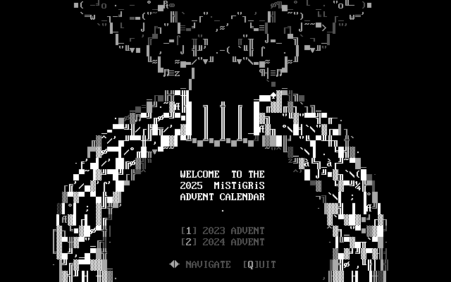

# MiSTiGRiS Advent Calendar



An interactive BBS door program that displays ANSI Christmas art, a new one each day in December. Browse past collections as well. Compatible with all modern BBS systems that support Door32 dropfiles -- Windows and Linux.

## Unified Repository Structure (2025+)

This repository now contains all versions of the Advent Calendar:

- **Go/Modern (Linux, Windows, Mac):** Main Go codebase in root (`cmd/`, `internal/`, etc.)
- **DOS (Legacy):** All Turbo Pascal and DOS-specific files are in `dos/` (NOT 100% functional!! see below)

### Directory Layout

```text
mg_advent/
├── cmd/           # Go entry point
├── internal/      # Go core modules
├── art/           # Modern art assets (Go version)
├── dos/           # All DOS/Turbo Pascal code and assets
│   ├── ADVENT.PAS
│   ├── *.DAT
│   ├── build_utils/
│   └── art/
│       ├── 2023/
│       ├── 2024/
│       ├── 2025/
│       └── common/
└── ...
```

## Quick Setup

### Windows

```batch
@echo off
set NODE=%1
if "%NODE%"=="" set NODE=1

cd /d "C:\bbs\doors\advent"
set DROPFILE_PATH=C:\bbs\temp\%NODE%\door32.sys

mg-advent.exe -path "%DROPFILE_PATH%"
```

### Linux

```bash
#!/bin/bash
NODE=${1:-1}
cd /opt/bbs/doors/advent
DROPFILE_PATH="/opt/bbs/temp/${NODE}/door32.sys"

./advent -path "$DROPFILE_PATH"
```

Make executable: `chmod +x advent.sh advent-linux-amd64`

### DOS (Legacy)

All DOS code and assets are in `dos/`. You need Turbo Pascal 7 or compatible.

**To build/run in DOSBox or real DOS:**

1. Enter the `dos/` directory:

 ```text
 cd dos
 ```

1. Open `ADVENT.PAS` in Turbo Pascal 7 and compile, or use batch/scripts in `build_utils/` if available.
2. Run the resulting executable in DOS or DOSBox.

Art assets for DOS are in `dos/art/` (identical structure to modern art/).

## Command Line Options

```text
-path string           Path to door32.sys file
-logon                 Logon mode: show current day's door, then COMEBACK.ANS and exit
-debug-date string     Override date (YYYY-MM-DD)
-debug-disable-date    Disable date validation
-local                 Run locally with UTF-8 art conversion
-nodetect              Use 80x25 without terminal probes
-noice                 Leave terminal ICE mode unchanged
```

## Building from Source

### For Modern Systems (Windows 10+, Linux, Mac)

Prerequisites: Go 1.21 or later, Git

```bash
# Clone repository
git clone https://github.com/robbiew/mg_advent.git
cd mg_advent

# Linux/Mac build (builds Linux amd64, arm64, and Windows 386)
./scripts/build.sh

# Windows build
go build -o mg-advent.exe ./cmd/advent
```

### BBS transport and Windows support

BBS connections, terminal probes, single-key input, and raw terminal setup now
use [GoDoors](https://github.com/robbiew/godoors). The Advent display engine keeps
its CP437 art processing, local UTF-8 conversion, overlays, scrolling, and ICE
settings. Navigation keys, local mode, logon mode, and the existing session timers
remain application features.

`-path` still accepts the full path to `door32.sys` (case-insensitive filename);
a directory containing it is also accepted. Windows uses the inherited socket
when supplied, while Linux/macOS and redirected Windows standard I/O use the
standard streams. No connection is made to a port inferred from a socket handle.
`-nodetect` opens the connection without issuing terminal queries. Detection
shares its buffered input with navigation so typed keys are retained.

Go 1.21 or later is required. Current Windows builds require Windows 10 / Server
2016 or later. The former Go 1.20 / Windows 7 build path is retired; the DOS tree
is unchanged. `WINDOWS7-FIX.md` is historical documentation for older releases.

Build directly on Windows with `go build -o mg-advent.exe ./cmd/advent`. The Unix
build script still produces Linux amd64/arm64 binaries and `mg-advent.exe` for
Windows 386, using the installed Go toolchain. Windows resources are optional.

When developing companion GoDoors API changes in a sibling checkout, create an
ignored local workspace with `go work init . ../godoors`. The module dependency
is pinned in `go.mod`; no local filesystem replacement is required in that file.
The companion revision must be published before a fresh clone or CI can download
it. Until then, use the sibling `codex/mg-advent-integration-api` branch in that
local workspace.

## Testing

```bash
# Local testing (no BBS required)
# Skip date restrictions to view any day's art
./advent -local -debug-disable-date -debug-date=2024-12-15
```

## Usage

- **Arrow Keys**: Navigate between days
- **1, 2, 3**: Jump to different years (2023, 2024, 2025)
- **Q or ESC**: Return to welcome screen / exit
- **I**: View info file
- **M**: View members list

## License

This project is released under the terms specified in the LICENSE file.

---

### Migration Note (2025)

The `dos/` directory is a work in progress and is not fully functional. The focus is on maintaining the modern Go version. Contributions to the DOS version are welcome but may require significant effort to bring it up to date.
